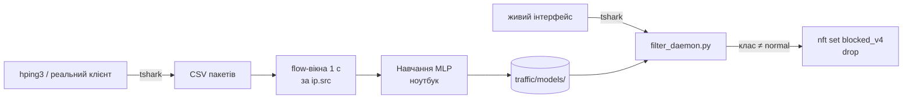

# Anomaly Detection

> Виявлення DDoS у мережевому трафіку нейромережею і автоматичне блокування джерел атак через nftables.


У репозиторії два пайплайни:

- **Трафік** — справжні pcap-дампи атак hping3 і нормального трафіку, MLP-класифікатор flow-вікон і фоновий демон, який блокує IP атакуючих у реальному часі.
- **Синтетика** — генератор навчальних подій кіберзагроз і ноутбуки лабораторних робіт з аналізу, очищення та кластеризації даних.

## Зміст

- [Як це працює](#як-це-працює)
- [Структура](#структура)
- [Швидкий старт](#швидкий-старт)
- [Модель](#модель)
- [Фільтр-демон](#фільтр-демон)
- [Офлайн-генерація правил](#офлайн-генерація-правил)
- [Синтетичні загрози](#синтетичні-загрози)
- [Документація](#документація)

## Як це працює



Кожна секунда трафіку від одного джерела згортається у 15 статистичних ознак: кількість пакетів і розмір, унікальні адреси та порти призначення, частки TCP/UDP/ICMP, частки прапорців SYN/ACK/FIN/RST/PSH, статистика інтервалів між пакетами. Класифікатор визначає, нормальний це трафік чи один із семи типів flood.

## Структура

```
.
├── traffic/                          реальний трафік і продакшн-частина
│   ├── generate_attacks.sh           захоплення pcap по класах атак (root, tshark, hping3)
│   ├── csv/                          витяги tshark і зведений cybersecurity_dataset.csv
│   ├── cybersecurity_dataset_overview.ipynb   ознаки, навчання MLP, збереження моделі
│   ├── cybersecurity_dataset_analysis.ipynb   розвідувальний аналіз
│   ├── flow_classifier.py            спільна агрегація у flow і обгортка над моделлю
│   ├── filter_daemon.py              фоновий фільтр живого трафіку
│   ├── anomaly-filter.service        systemd-юніт демона
│   ├── generate_nft_from_classification.py    CSV → rules.nft
│   ├── rules.nft                     приклад згенерованих правил
│   └── test_filter_logic.py          тести логіки демона
├── synthetic/                        синтетичні загрози для лабораторних
│   ├── generate_threats.py
│   ├── cyber_threats_*.ipynb, cyber_clustering.ipynb
│   └── *.csv
└── docs/                             тексти лабораторних і звіти з розбору дампів
```

## Швидкий старт

```bash
git clone https://github.com/YaTut1901/anomaly-detection.git
cd anomaly-detection

python3 -m venv .venv && source .venv/bin/activate
pip install pandas numpy scikit-learn tensorflow joblib matplotlib seaborn jupyter
```

Системні залежності для захоплення і блокування: `tshark`, `nftables`, для генерації атак ще `hping3`.

1. Навчити і зберегти модель — виконати `traffic/cybersecurity_dataset_overview.ipynb` **з каталогу `traffic/`**. Ноутбук запише `traffic/models/cyber_flow_classifier.keras` і `traffic/models/cyber_flow_artifacts.joblib` (scaler, label encoder, порядок ознак). Каталог `models/` не комітиться.
2. Перевірити демон без змін у фаєрволі:

   ```bash
   sudo .venv/bin/python traffic/filter_daemon.py --dry-run
   ```

3. Запустити у фоні:

   ```bash
   sudo .venv/bin/python traffic/filter_daemon.py --daemon
   ```

## Модель

MLP на Keras:

```
Dense(64, ReLU) → Dense(32, ReLU) → Dense(8, softmax)
```

Adam, `sparse_categorical_crossentropy`, 20 епох, `StandardScaler` на ознаках, стратифікований поділ 80/20.

Класи: `normal`, `syn`, `ack`, `fin`, `rst`, `push`, `udp`, `icmp`.

Якість на відкладених 197 flow-вікнах:

| Метрика | Значення |
|---------|----------|
| Test accuracy | **99.49%** |
| Macro F1 | 0.99 |
| Weighted F1 | 1.00 |

Сім класів мають F1 1.00; найслабший — precision 0.92, F1 0.96.

Атаки записані на loopback з одним фіксованим джерелом на клас, тож на реальній мережі якість може бути нижчою. Крім того, до ознак моделі зараз потрапляють `t_bucket` (номер секунди) і `ip_src_numeric` (IP джерела як число). На навчальних даних вони фактично підказують клас, а на живому трафіку нічого не означають. Перед бойовим запуском варто прогнати демон у `--dry-run` на своєму трафіку.

## Фільтр-демон

`traffic/filter_daemon.py` — окремий процес, який:

1. знімає живий IPv4 через `tshark` на інтерфейсі default route (або `--interface`);
2. щойно секундне вікно закрилось, будує ті самі ознаки, що й при навчанні;
3. класифікує вікна збереженою моделлю;
4. для класу поза allow-list з упевненістю від `--min-confidence` додає IP джерела в nft set.

Правила живуть в окремій таблиці і не чіпають решту фаєрвола:

```
table inet cyber_cls {
  set blocked_v4 { type ipv4_addr; }
  chain input_cls {
    type filter hook input priority -100; policy accept;
    ip saddr @blocked_v4 drop
  }
}
```

Захист від самоблокування: ніколи не блокуються loopback, link-local, multicast, `0.0.0.0/8`, адреси самого хоста, шлюз за замовчуванням і все з `--allow-ips`. Кількість адрес у set обмежена `--max-blocks` (500), щоб flood із підробленими джерелами не роздув правила.

### Керування

```bash
sudo .venv/bin/python traffic/filter_daemon.py --dry-run   # лише лог, nft не змінюється
sudo .venv/bin/python traffic/filter_daemon.py --daemon    # у фон, pid і лог у traffic/run/
sudo .venv/bin/python traffic/filter_daemon.py --stop      # SIGTERM процесу з pid-файла

sudo nft list set inet cyber_cls blocked_v4                # хто заблокований
sudo nft delete element inet cyber_cls blocked_v4 '{ 203.0.113.9 }'   # розблокувати
sudo nft delete table inet cyber_cls                       # зняти все
```

Після зупинки блокування лишаються. Щоб демон знімав таблицю при виході, додайте `--flush-on-stop`.

### Параметри

| Прапорець | За замовчуванням | Призначення |
|-----------|------------------|-------------|
| `--interface` | інтерфейс default route | де слухати трафік |
| `--allow-classes` | `normal` | класи, які не блокуються |
| `--min-confidence` | `0.5` | мінімальна ймовірність класу |
| `--min-packets` | `1` | мінімум пакетів у вікні |
| `--allow-ips` | — | IP через кому, які ніколи не блокувати |
| `--no-protect-gateway` | — | дозволити блокувати шлюз |
| `--max-blocks` | `500` | ліміт адрес у set |
| `--window` | `1.0` | довжина вікна, с (має збігатися з навчанням) |
| `--model`, `--artifacts` | `traffic/models/…` | шляхи до моделі |

### systemd

```bash
sudo cp traffic/anomaly-filter.service /etc/systemd/system/
sudo systemctl daemon-reload
sudo systemctl enable --now anomaly-filter
journalctl -u anomaly-filter -f
```

`ExecStart` у юніті вказує на `.venv` цього клону в `/home/ivan/Projects/anomaly-detection`. Якщо репозиторій лежить деінде, змініть шлях.

### Тести

```bash
.venv/bin/python traffic/test_filter_logic.py
```

Перевіряють розбір рядків tshark, закриття вікон, агрегацію у flow, рішення про блокування і захищені адреси. Для них не потрібні root, tshark і модель.

## Офлайн-генерація правил

Класифікувати готовий CSV пакетів і записати статичний `rules.nft`:

```bash
python traffic/generate_nft_from_classification.py --csv traffic/csv/sample_live_traffic.csv
sudo nft -c -f traffic/rules.nft   # перевірка синтаксису
sudo nft -f traffic/rules.nft      # застосування
```

## Синтетичні загрози

`synthetic/generate_threats.py` генерує навчальні події: протокол, прапорець, публічні IPv4, порти, розмір пакета, тип загрози, час і країну. Країна за замовчуванням детермінована від IP; з `--geoip-country-db` береться з GeoLite2.

```bash
python synthetic/generate_threats.py 200 --missing-cell-prob 0.08
```

Результат — `synthetic/cyber_threats_dataset.csv`. Ноутбуки запускаються з каталогу `synthetic/`:

| Ноутбук | Що робить |
|---------|-----------|
| `cyber_threats_preprocessing.ipynb` | пропуски, дати, аномалії, масштабування; пише `processed_dataset.csv` і `cleaned_data.csv` |
| `cyber_threats_analysis.ipynb` | розподіли типів загроз, протоколів, країн, IP |
| `cyber_clustering.ipynb` | KMeans, DBSCAN, agglomerative clustering |

## Документація

| Файл | Зміст |
|------|-------|
| [`docs/tshark_feature_extraction_report.md`](docs/tshark_feature_extraction_report.md) | які поля tshark витягувати і чому |
| [`docs/normal_traffic_wireshark_analysis.md`](docs/normal_traffic_wireshark_analysis.md) | розбір дампу нормального трафіку |
| [`docs/lab_cyber_threats.md`](docs/lab_cyber_threats.md) | генерація синтетичного датасету |
| [`docs/lab_threats_analysis.md`](docs/lab_threats_analysis.md) | аналіз даних кіберзагроз |
| [`docs/lab_threats_preprocessing.md`](docs/lab_threats_preprocessing.md) | обробка й очищення даних |
| [`docs/lab_cyber_clustering.md`](docs/lab_cyber_clustering.md) | кластеризація |
