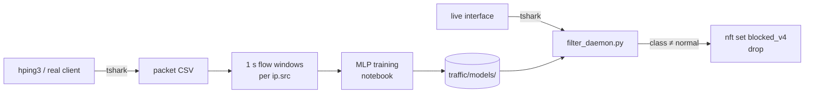

# Anomaly Detection

> Detect DDoS traffic with a neural network and automatically block attack sources with nftables.


The repository contains two pipelines:

- **Traffic** — real pcap captures of hping3 floods and normal traffic, an MLP classifier over flow windows, and a background daemon that blocks attacking IPs in real time.
- **Synthetic** — a generator of training cyber-threat events and lab notebooks for data analysis, cleaning and clustering.

## Contents

- [How it works](#how-it-works)
- [Layout](#layout)
- [Quick start](#quick-start)
- [Model](#model)
- [Filter daemon](#filter-daemon)
- [Offline rule generation](#offline-rule-generation)
- [Synthetic threats](#synthetic-threats)
- [Documentation](#documentation)

## How it works



Every second of traffic from one source is aggregated into 15 statistical features: packet count and size, unique destination addresses and ports, TCP/UDP/ICMP shares, SYN/ACK/FIN/RST/PSH flag shares, and inter-arrival time statistics. The classifier decides whether the window is normal traffic or one of seven flood types.

## Layout

```
.
├── traffic/                          real traffic and the production part
│   ├── generate_attacks.sh           per-class pcap capture (root, tshark, hping3)
│   ├── csv/                          tshark extracts and the combined cybersecurity_dataset.csv
│   ├── cybersecurity_dataset_overview.ipynb   features, MLP training, model export
│   ├── cybersecurity_dataset_analysis.ipynb   exploratory analysis
│   ├── flow_classifier.py            shared flow aggregation and model wrapper
│   ├── filter_daemon.py              background filter for live traffic
│   ├── anomaly-filter.service        systemd unit for the daemon
│   ├── generate_nft_from_classification.py    CSV → rules.nft
│   ├── rules.nft                     example of generated rules
│   └── test_filter_logic.py          daemon logic tests
├── synthetic/                        synthetic threats for the labs
│   ├── generate_threats.py
│   ├── cyber_threats_*.ipynb, cyber_clustering.ipynb
│   └── *.csv
└── docs/                             lab write-ups and capture analysis reports (Ukrainian)
```

## Quick start

```bash
git clone https://github.com/YaTut1901/anomaly-detection.git
cd anomaly-detection

python3 -m venv .venv && source .venv/bin/activate
pip install pandas numpy scikit-learn tensorflow joblib matplotlib seaborn jupyter
```

System dependencies for capture and blocking: `tshark`, `nftables`; `hping3` to generate attacks.

1. Train and save the model by running `traffic/cybersecurity_dataset_overview.ipynb` **from the `traffic/` directory**. It writes `traffic/models/cyber_flow_classifier.keras` and `traffic/models/cyber_flow_artifacts.joblib` (scaler, label encoder, feature order). The `models/` directory is not committed.
2. Check the daemon without touching the firewall:

   ```bash
   sudo .venv/bin/python traffic/filter_daemon.py --dry-run
   ```

3. Run it in the background:

   ```bash
   sudo .venv/bin/python traffic/filter_daemon.py --daemon
   ```

## Model

Keras MLP:

```
Dense(64, ReLU) → Dense(32, ReLU) → Dense(8, softmax)
```

Adam, `sparse_categorical_crossentropy`, 20 epochs, `StandardScaler` on features, stratified 80/20 split.

Classes: `normal`, `syn`, `ack`, `fin`, `rst`, `push`, `udp`, `icmp`.

Results on 197 held-out flow windows:

| Metric | Value |
|--------|-------|
| Test accuracy | **99.49%** |
| Macro F1 | 0.99 |
| Weighted F1 | 1.00 |

Seven classes reach F1 1.00; the weakest has precision 0.92 and F1 0.96.

The attacks were recorded on loopback with one fixed source per class, so quality on a real network may be lower. The model's features also currently include `t_bucket` (the second number) and `ip_src_numeric` (source IP as an integer). On the training data they effectively leak the class; on live traffic they carry no meaning. Run the daemon with `--dry-run` on your own traffic before enforcing.

## Filter daemon

`traffic/filter_daemon.py` is a separate process that:

1. captures live IPv4 with `tshark` on the default-route interface (or `--interface`);
2. as soon as a one-second window closes, builds the same features used in training;
3. classifies the windows with the saved model;
4. for any class outside the allow list with confidence at least `--min-confidence`, adds the source IP to an nft set.

Rules live in a dedicated table and leave the rest of the firewall alone:

```
table inet cyber_cls {
  set blocked_v4 { type ipv4_addr; }
  chain input_cls {
    type filter hook input priority -100; policy accept;
    ip saddr @blocked_v4 drop
  }
}
```

Self-lockout protection: loopback, link-local, multicast, `0.0.0.0/8`, the host's own addresses, the default gateway and anything in `--allow-ips` are never blocked. The set size is capped by `--max-blocks` (500) so a flood with spoofed sources cannot blow up the rules.

### Control

```bash
sudo .venv/bin/python traffic/filter_daemon.py --dry-run   # log only, nft untouched
sudo .venv/bin/python traffic/filter_daemon.py --daemon    # detach; pid and log in traffic/run/
sudo .venv/bin/python traffic/filter_daemon.py --stop      # SIGTERM the process from the pid file

sudo nft list set inet cyber_cls blocked_v4                # who is blocked
sudo nft delete element inet cyber_cls blocked_v4 '{ 203.0.113.9 }'   # unblock one IP
sudo nft delete table inet cyber_cls                       # remove everything
```

Blocks persist after the daemon stops. Pass `--flush-on-stop` to remove the table on exit.

### Options

| Flag | Default | Purpose |
|------|---------|---------|
| `--interface` | default-route interface | where to capture |
| `--allow-classes` | `normal` | classes that are never blocked |
| `--min-confidence` | `0.5` | minimum class probability |
| `--min-packets` | `1` | minimum packets in a window |
| `--allow-ips` | — | comma-separated IPs that are never blocked |
| `--no-protect-gateway` | — | allow blocking the gateway |
| `--max-blocks` | `500` | cap on addresses in the set |
| `--window` | `1.0` | window length in seconds (must match training) |
| `--model`, `--artifacts` | `traffic/models/…` | model paths |

### systemd

```bash
sudo cp traffic/anomaly-filter.service /etc/systemd/system/
sudo systemctl daemon-reload
sudo systemctl enable --now anomaly-filter
journalctl -u anomaly-filter -f
```

`ExecStart` in the unit points to the `.venv` of this clone at `/home/ivan/Projects/anomaly-detection`. Change the path if the repository lives elsewhere.

### Tests

```bash
.venv/bin/python traffic/test_filter_logic.py
```

They cover tshark line parsing, window closing, flow aggregation, block decisions and protected addresses. They need no root, tshark or model.

## Offline rule generation

Classify an existing packet CSV and write a static `rules.nft`:

```bash
python traffic/generate_nft_from_classification.py --csv traffic/csv/sample_live_traffic.csv
sudo nft -c -f traffic/rules.nft   # syntax check
sudo nft -f traffic/rules.nft      # apply
```

## Synthetic threats

`synthetic/generate_threats.py` generates training events: protocol, flag, public IPv4 addresses, ports, packet size, threat type, timestamp and country. Country is derived deterministically from the IP by default; with `--geoip-country-db` it comes from GeoLite2.

```bash
python synthetic/generate_threats.py 200 --missing-cell-prob 0.08
```

Output goes to `synthetic/cyber_threats_dataset.csv`. Run the notebooks from the `synthetic/` directory:

| Notebook | What it does |
|----------|--------------|
| `cyber_threats_preprocessing.ipynb` | missing values, dates, outliers, scaling; writes `processed_dataset.csv` and `cleaned_data.csv` |
| `cyber_threats_analysis.ipynb` | distributions of threat types, protocols, countries, IPs |
| `cyber_clustering.ipynb` | KMeans, DBSCAN, agglomerative clustering |

## Documentation

The documents in `docs/` are in Ukrainian.

| File | Topic |
|------|-------|
| [`docs/tshark_feature_extraction_report.md`](docs/tshark_feature_extraction_report.md) | which tshark fields to extract and why |
| [`docs/normal_traffic_wireshark_analysis.md`](docs/normal_traffic_wireshark_analysis.md) | analysis of the normal traffic capture |
| [`docs/lab_cyber_threats.md`](docs/lab_cyber_threats.md) | synthetic dataset generation |
| [`docs/lab_threats_analysis.md`](docs/lab_threats_analysis.md) | cyber-threat data analysis |
| [`docs/lab_threats_preprocessing.md`](docs/lab_threats_preprocessing.md) | data processing and cleaning |
| [`docs/lab_cyber_clustering.md`](docs/lab_cyber_clustering.md) | clustering |
